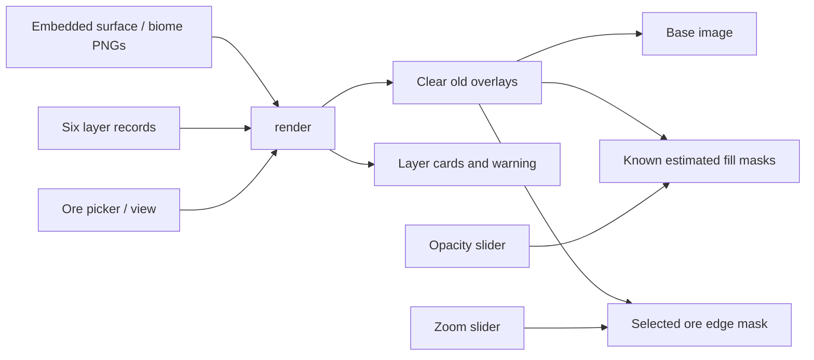

[English](ARCHITECTURE.en.md) | [Magyar](ARCHITECTURE.hu.md) · [README](../README.md)

# Architecture
V10 is a documentation release of the unchanged V9 runtime. A single UTF-8 HTML file contains HTML, CSS, JS, 18 PNG data URIs and a non-executable Hungarian reconstruction document. No libraries, backend, API requests or build step at runtime. The interface remains Hungarian in both documentation languages.

## DOM and layout
`html[lang=hu]` → implicit `head` (charset, text/plain documentation, viewport, title, style) → implicit `body` (header, main, footer, executable script). Main contains `section.panel` then `aside.panel`. Section: `.toolbar` (hidden `#ore`, `#mode`, `#zoom`/`#zval`, `#reset`, `#gridon`, `#opacity`), `#viewport > #stage > #base, #overlay.maplayer, #outlines.maplayer, #grid`, `#coord`, `#status`, `details > summary + #regions`. Aside: title, description, `#picker` (buttons with `data-ore`, `.rarity` headings), `.detailheading`, `#layers` (dynamic `.layer`, `.ore`, buttons and values). Footer has three source links. The exact CSS, DOM, literal UI strings, event handlers and JS are preserved in the embedded `BEGIN_V9_TEMPLATE` block; do not rewrite them from a visual approximation.

Desktop: flexible map, 355px sidebar, 16px gap/padding; <=900px responsive rule in original CSS (see template for exact media expression), sidebar first; viewport height min(66vh,760px), mobile 52vh. Stage 2:1, min-width 300px. Native image layers absolute/inset 0, grid pointer-transparent. System-ui and Consolas; categories use 3px left accent. Edges are single-pixel raster masks with #fff0a0, not an SVG stroke. 0.65 CSS px was a design target, not a guarantee; actual thickness depends on zoom and mask resolution.

## Functions
| Function | Input / output | Behavior |
|---|---|---|
| `$` | ID → element/null | DOM lookup |
| `pick` | ore name or empty → void | set ore, switch to estimate, render |
| `syncPicker` | none → void | update aria-pressed from selected name |
| `setBase` | URI → void | assign base src only if different |
| `addImage` | parent, URI, layer ID → void | create image, empty alt, data-layer; mark loaded on success; remove and report on failure |
| `drawOutlines` | selected layers → void | clear; exit if not estimate or no ore; select mask resolution by stage width/8192 (>0.65 → 1; >0.29 → 2; else 4); append only known masks |
| `render` | none → void | update buttons, select layers, regenerate cards and warning, set base and opacity, clear both overlays, append applicable fill masks and draw outlines |

## Event flow
Picker and layer-card clicks use closest `button[data-ore]`; empty means all ores. `ore.onchange` and `mode.onchange` render. `opacity.oninput` changes fill only. `zoom.oninput` adjusts stage width 100–800%, updates value, redraws edges. `gridon.onchange` toggles grid. Reset sets all ores, estimate, 1×, 45%, grid on and scroll (0,0), then render. Pointer down captures pointer and initial scroll, move pans, up/cancel releases state; mousemove computes texture longitude/latitude from stage bounds. Native select/button keyboard activation and details expand/collapse; no custom keyboard shortcuts. Start calls render. Source links are optional navigation.

## Three views
- Estimate (`estimate`): original surface plus three common fills by default; single ore shows only its estimated mask, if any, plus edge. Gold and five other unknown-location ores clear all overlays; surface and data cards remain.
- Biome (`biome`): original biome PNG; no fills or edges.
- Surface (`surface`): original surface PNG; no fills or edges.

Grid is independent. Zoom and opacity do not alter source data. Geometry: [DATA](DATA.en.md), images: [IMAGES](IMAGES.en.md), exact source reconstruction: [REBUILD](REBUILD.en.md).
