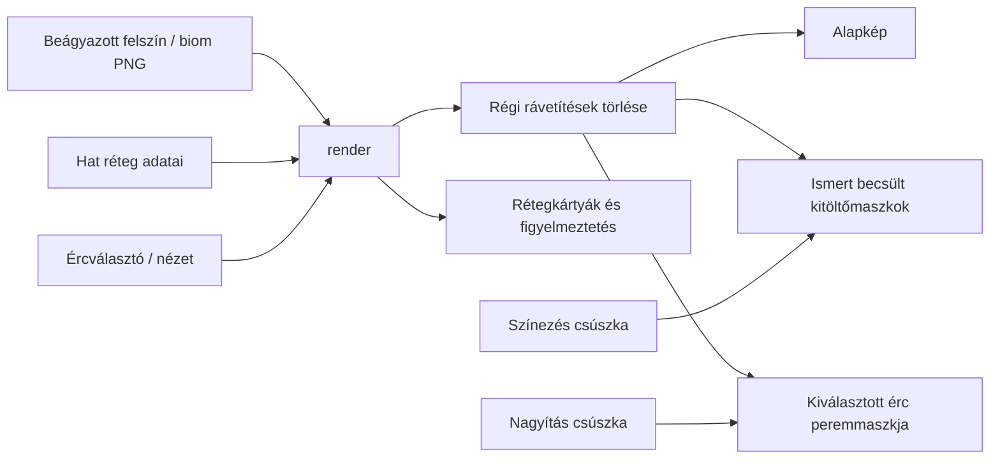

[English](ARCHITECTURE.en.md) | [Magyar](ARCHITECTURE.hu.md) · [README](../README.hu.md)

# Architektúra
A V10 dokumentációs kiadás, a változatlan V9 futó programmal. Egy UTF-8 HTML tartalmazza a HTML-t, CSS-t, JS-t, 18 PNG data URI-t és a nem futtatható magyar újraépítési dokumentációt. Futáskor nincs könyvtár, háttérszerver, API-kérés vagy build-lépés. A felület mindkét dokumentációs nyelv mellett magyar marad.

## DOM és elrendezés
`html[lang=hu]` → implicit `head` (charset, text/plain dokumentáció, viewport, title, style) → implicit `body` (header, main, footer, futtatható script). A main elemei: `section.panel`, majd `aside.panel`. Section: `.toolbar` (rejtett `#ore`, `#mode`, `#zoom`/`#zval`, `#reset`, `#gridon`, `#opacity`), `#viewport > #stage > #base, #overlay.maplayer, #outlines.maplayer, #grid`, `#coord`, `#status`, `details > summary + #regions`. Aside: cím, leírás, `#picker` (`data-ore` gombok, `.rarity` címek), `.detailheading`, `#layers` (dinamikus `.layer`, `.ore`, gombok és értékek). A lábléc három forráslinket tartalmaz. A pontos CSS, DOM, szó szerinti feliratok, eseménykezelők és JS a beágyazott `BEGIN_V9_TEMPLATE` blokkban vannak; ne próbáld vizuális közelítésből újraírni.

Asztalon rugalmas térkép, 355px oldalsáv, 16px térköz/belső margó; legfeljebb 900px-es mobil szabály az eredeti CSS-ben (a pontos media feltétel a sablonban), oldalsáv elöl; viewport magasság min(66vh,760px), mobilon 52vh. Stage 2:1, min-width 300px. Abszolút kép rétegek, inset 0; a rács nem fogja az egéreseményeket. System-ui és Consolas; 3px bal oldali kategóriaszín. A perem egy maszkpixel széles #fff0a0 raszter, nem SVG stroke. A 0,65 CSS-pixel tervezési cél volt, nem garancia; a tényleges vastagság a nagyítástól és a maszk felbontásától függ.

## Függvények
| Függvény | Bemenet / kimenet | Működés |
|---|---|---|
| `$` | ID → elem/null | DOM-keresés |
| `pick` | ércnév vagy üres → nincs | érc beállítása, estimate nézet, render |
| `syncPicker` | nincs → nincs | aria-pressed frissítése a kiválasztott névből |
| `setBase` | URI → nincs | csak eltérésnél állítja a base src-t |
| `addImage` | szülő, URI, réteg-ID → nincs | kép létrehozása, üres alt, data-layer; siker esetén loaded jelzés, hiba esetén eltávolítás és üzenet |
| `drawOutlines` | kiválasztott rétegek → nincs | törlés; kilép, ha nem estimate vagy nincs érc; stage szélesség/8192 alapján maszk (>0.65 → 1; >0.29 → 2; különben 4); csak ismert maszkok hozzáadása |
| `render` | nincs → nincs | gombok frissítése, rétegszűrés, kártyák és figyelmeztetés, alapkép és opacity, mindkét rávetítés törlése, megfelelő kitöltések és peremek hozzáadása |

## Eseményfolyam
A választó és rétegkártya kattintása a legközelebbi `button[data-ore]` elemet keresi; üres érték: minden érc. `ore.onchange`, `mode.onchange`: render. `opacity.oninput`: csak a kitöltés változik. `zoom.oninput`: stage szélesség 100–800%, értékfrissítés, perem újrarajzolása. `gridon.onchange`: hálózat kapcsolása. Alaphelyzet: minden érc, estimate, 1×, 45%, hálózat be, scroll (0,0), render. Pointer down: pointer elfogása és kezdeti scroll; move: húzás, up/cancel: állapot törlése; mousemove: textúra hosszúság/szélesség a stage befoglaló keretéből. Natív gomb- és select-billentyűkezelés, details nyitás-zárás; nincs saját gyorsbillentyű. Induláskor render. A forráslinkek opcionális navigációk.

## Három nézet
- Becslés (`estimate`): eredeti felszín, alapból három közös kitöltés; egy ércnél csak annak becsült maszkja, ha van, és pereme. Gold és öt további ismeretlen helyű érc törli a rávetítéseket; a felszín és adatlap megmarad.
- Biom (`biome`): eredeti biom PNG, nincs kitöltés vagy perem.
- Felszín (`surface`): eredeti felszíni PNG, nincs kitöltés vagy perem.

A hálózat független. A nagyítás és színezés nem módosítja a forrásadatot. Geometria: [DATA](DATA.hu.md), képek: [IMAGES](IMAGES.hu.md), pontos újraépítés: [REBUILD](REBUILD.hu.md).
